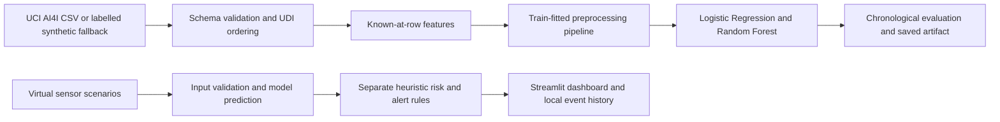
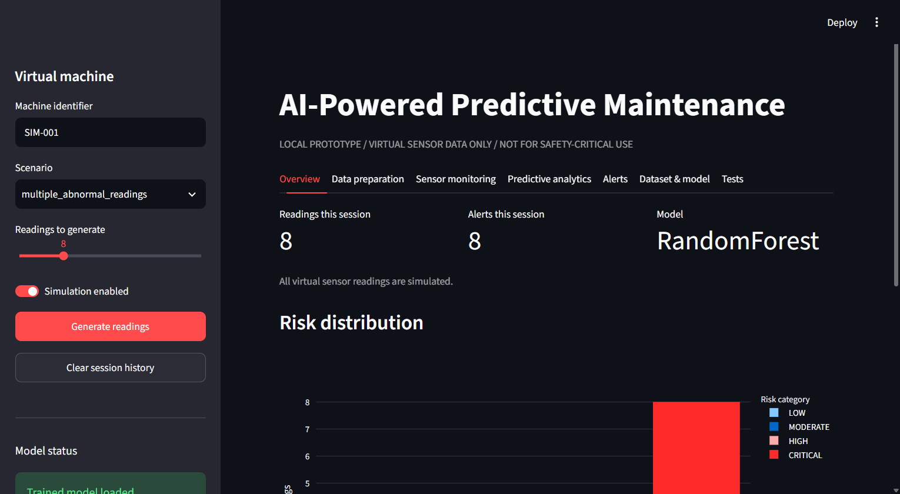
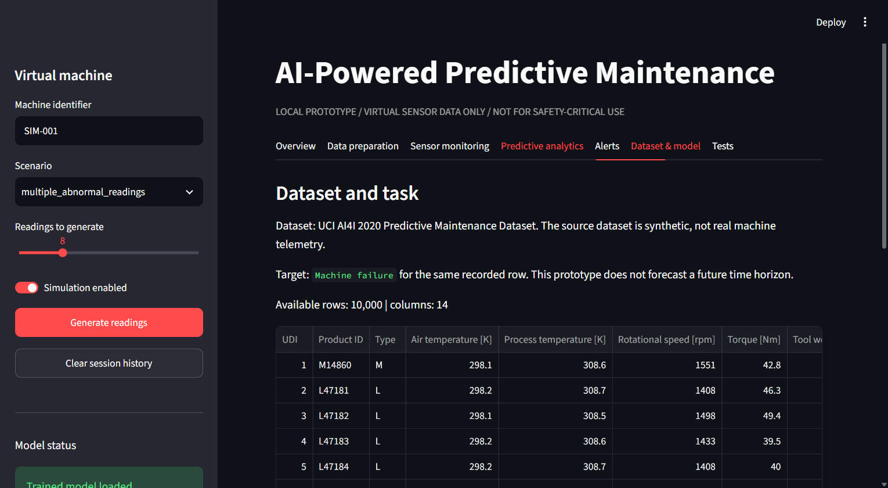
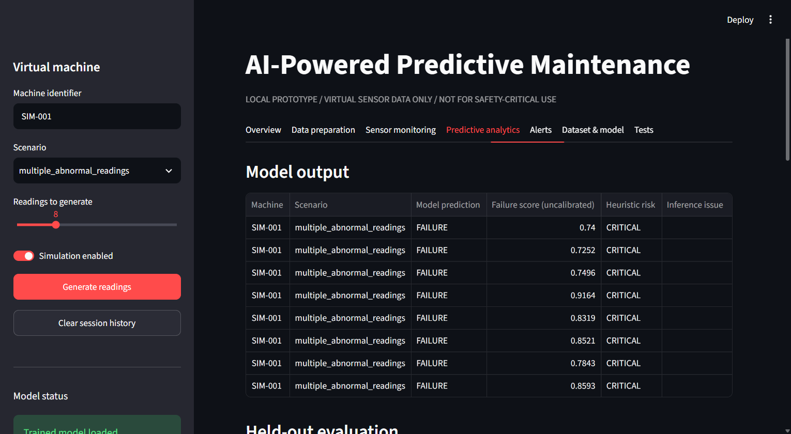
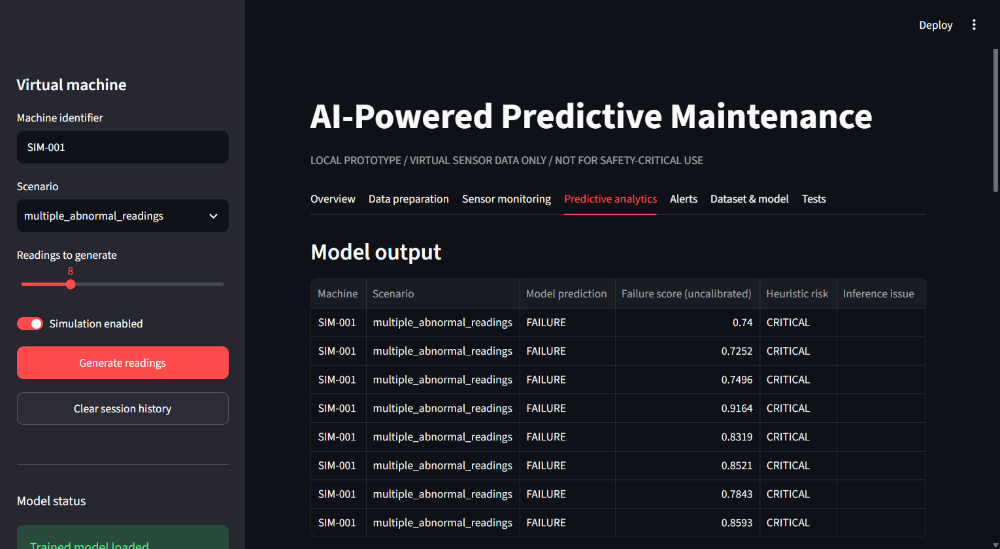
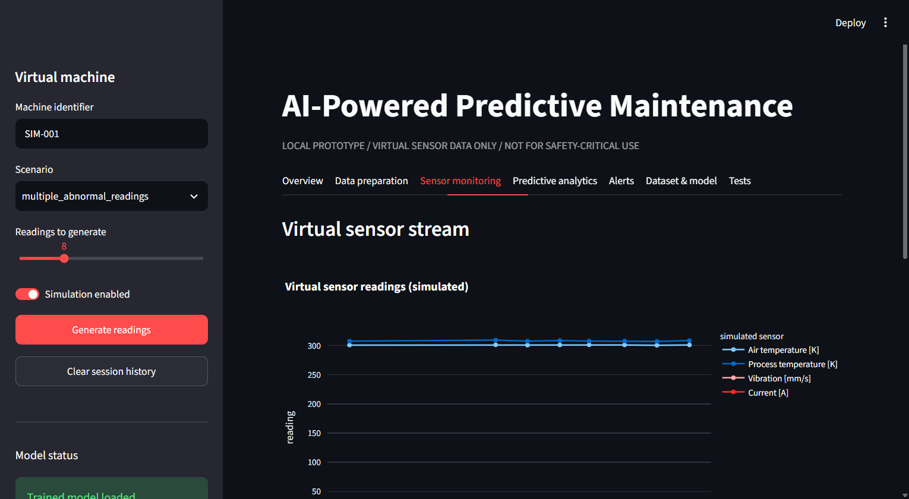
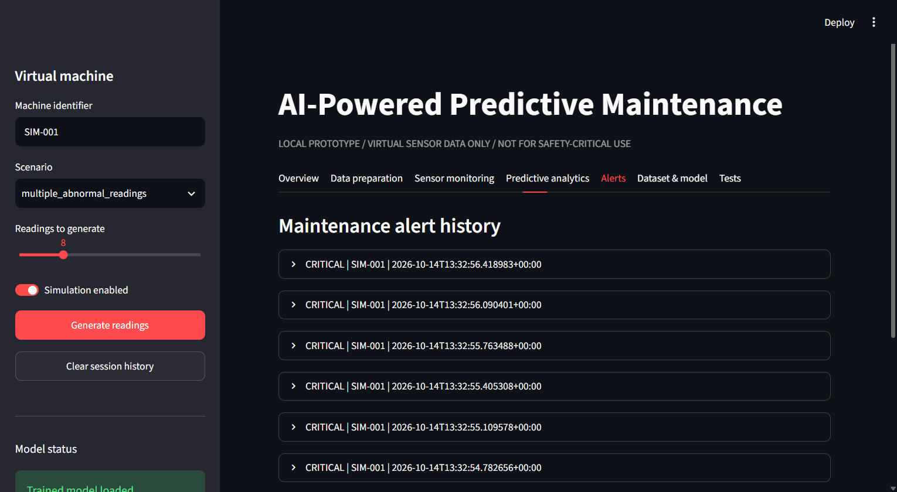
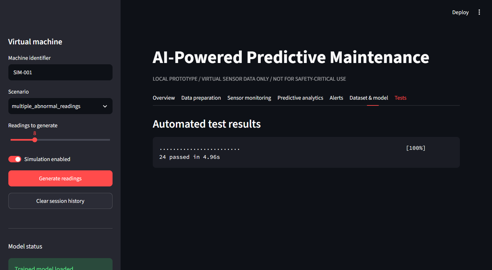

# AI-Powered Predictive Maintenance System for IoT Devices

A local, CPU-friendly learning prototype for inspecting machine-condition records, classifying the failure label attached to a recorded operating row, and exploring virtual sensor scenarios. It is a portfolio and learning project, not a production maintenance or safety system.

## Problem and Objectives

Unexpected equipment stoppages can interrupt production and increase maintenance cost. This project demonstrates an educational machine-learning workflow for examining process-condition records, comparing failure classifiers, and showing how a simulated monitoring workflow could surface unusual readings for investigation.

Objectives:

- Inspect and validate a documented predictive-maintenance dataset.
- Engineer interpretable features and compare a simple baseline with a tree model.
- Evaluate on a chronological holdout and expose the class-imbalance trade-off.
- Simulate virtual readings, distinguish classifier results from heuristic warnings, and display them in a local dashboard.

Industry relevance: condition monitoring and maintenance prioritization are common industrial analytics use cases. This project demonstrates the analysis workflow only; its synthetic data and same-row target do not establish operational or future-failure capability.

## What It Does

- Downloads the documented UCI AI4I 2020 dataset, or creates a clearly labelled synthetic fallback when offline.
- Validates the dataset, keeps the downloaded original unchanged, engineers temperature-difference and estimated-power features, and saves a processed feature table.
- Compares class-weighted Logistic Regression and Random Forest using a chronological UDI holdout; all learned imputation, encoding, and scaling live in the model pipeline and fit on training rows only.
- Produces evaluation reports, a confusion-matrix figure, feature importance, a reusable prediction function, seedable virtual sensor scenarios, heuristic risk scores, and an alert history.
- Provides a local Streamlit dashboard. Every virtual reading is labelled simulated.

## Technology Stack

Python 3.14.6 was verified in this environment. The isolated project environment installs Pandas, NumPy, scikit-learn, Joblib, Matplotlib, Plotly, Streamlit, and pytest from `requirements.txt`. The application is CPU-friendly and requires no GPU, paid service, cloud account, or physical sensor.

## Prediction Objective

The target is the dataset's `Machine failure` label for the **same recorded row**. This demonstrates row-level failure classification using available sensor fields. It does not forecast a future time window, remaining useful life, an exact breakdown time, or a calibrated failure probability. Model scores are uncalibrated classifier outputs; heuristic risk scores are separate rule-based indicators.

## Dataset

The project uses the UCI Machine Learning Repository's [AI4I 2020 Predictive Maintenance Dataset](https://archive.ics.uci.edu/dataset/601/ai4i+2020+predictive+maintenance+dataset), DOI [10.24432/C5HS5C](https://doi.org/10.24432/C5HS5C). UCI describes the 10,000-row CSV as **synthetic data reflecting industrial predictive-maintenance data**, not real machine measurements. The dataset is CC BY 4.0; provide attribution when redistributing it. More field, target, licensing, and limitation details are in [docs/DATASET_DOCUMENTATION.md](docs/DATASET_DOCUMENTATION.md).

Training excludes `UDI`, `Product ID`, and failure-mode labels (`TWF`, `HDF`, `PWF`, `OSF`, `RNF`) to avoid identifiers and direct target leakage. Input fields are product `Type`, air and process temperature, rotational speed, torque, and tool wear. Rows are ordered by UDI; the first 80% train the models and the final 20% are held out for testing.

### Published Columns

| Column | Meaning / use |
|---|---|
| `UDI` | Unique row identifier; order/split only, not a model input. |
| `Product ID` | Product identifier; excluded. |
| `Type` | L/M/H product type; input. |
| `Air temperature [K]` | Air temperature in kelvin; input. |
| `Process temperature [K]` | Process temperature in kelvin; input. |
| `Rotational speed [rpm]` | Speed in revolutions per minute; input. |
| `Torque [Nm]` | Torque in newton-metres; input. |
| `Tool wear [min]` | Tool wear time in minutes; input. |
| `Machine failure` | Failure label for this row; target. |
| `TWF`, `HDF`, `PWF`, `OSF`, `RNF` | Failure-mode labels; excluded to prevent target leakage. |

The pipeline derives temperature difference and estimated mechanical power from the input values. The source has no machine identifier or timestamp; UDI is used as the available ordering proxy.

## Actual Evaluation

Generated by the checked-in training workflow on the official 10,000-row UCI file. The held-out period is UDI 8001-10000 (2,000 rows, 39 failure labels). Selection uses failure-class F1, then failure-class recall.

| Model | Accuracy | Failure precision | Failure recall | Failure F1 | ROC AUC |
|---|---:|---:|---:|---:|---:|
| Logistic Regression | 0.946 | 0.218 | 0.692 | 0.331 | 0.909 |
| Random Forest (selected) | 0.993 | 1.000 | 0.615 | 0.762 | 0.948 |

The selected model found 24 of 39 held-out failures and missed 15; its precision of 1.000 is based on only 24 positive predictions. These results are dataset-specific and do not establish real-world performance. Full unrounded metrics and confusion matrices are saved in `outputs/reports/model_metrics.json`; the plotted matrix is `outputs/figures/confusion_matrix.png`.

## Architecture



## Project Structure

```text
dashboard/app.py                 Streamlit interface
data/raw/                        Downloaded UCI CSV (ignored; re-downloadable)
data/sample/README.md            Synthetic offline fallback details
docs/                             Architecture, dataset, model card, limitations
images/screenshots/              Genuine dashboard and test captures
models/                           Trained Joblib artifact (ignored; regenerate)
outputs/figures/                  Confusion matrix
outputs/predictions/              Local event history (ignored)
outputs/reports/                  Model metrics and test summary
src/predictive_maintenance/       Reusable Python package
tests/                            Offline pytest suite
main.py                           Training and simulation CLI
requirements.txt                  Runtime and test dependencies
```

Heuristic alerts use transparent additive points, capped at 100: simulated shutdown +100; invalid required sensor +30; temperature difference below 8.6 K +25; estimated power outside 3,500-9,000 W +30; wear at least 200 min +25 or 150 min +15; demo vibration at least 8 mm/s +30 or 6 mm/s +15; demo current below 3 A or above 13 A +15. Categories are LOW 0-29, MODERATE 30-54, HIGH 55-79, CRITICAL 80-100. These illustrative rules are neither learned nor calibrated failure probabilities; see [docs/MODEL_CARD.md](docs/MODEL_CARD.md).

## Environment and Run

Python 3.14.6 was checked in this workspace; the current NumPy, pandas, scikit-learn, Joblib, Streamlit, and pytest versions resolve for it. Python 3.13 is also installed. No global Python installation is changed. In PowerShell, from the project root:

```powershell
py -3.14 -m venv .venv
.\.venv\Scripts\python.exe -m pip install --upgrade pip
.\.venv\Scripts\python.exe -m pip install -r requirements.txt -e .
.\.venv\Scripts\python.exe main.py train
.\.venv\Scripts\python.exe -m streamlit run dashboard/app.py
```

Open the local URL printed by Streamlit (normally `http://localhost:8501`). Training attempts the official UCI download. If unavailable, it creates `data/sample/synthetic_ai4i_demo.csv` from a documented deterministic generator and reports that the fallback was used. The app can also be opened without a trained model; it shows setup guidance and keeps simulation available.

Generate and assess one simulated case:

```powershell
.\.venv\Scripts\python.exe main.py simulate --scenario multiple_abnormal_readings --seed 42
```

Scenarios include normal operation, rising process temperature, abnormal vibration, current fluctuation, combined abnormal readings, an invalid sensor value, and a simulated shutdown. Simulation never connects to or controls equipment. Vibration and current are demonstration-only fields; they are not present in the UCI dataset and are not model inputs.

### Sample Prediction

This is actual output from the command above in the verified project environment. The sensor row is simulated; the score is explicitly uncalibrated.

```json
{
	"scenario": "multiple_abnormal_readings",
	"simulation": true,
	"prediction": "FAILURE",
	"model_failure_probability": 0.8593,
	"model_probability_is_calibrated": false,
	"risk_category": "CRITICAL",
	"heuristic_risk_score": 95,
	"alert": true
}
```

Run tests without network access:

```powershell
.\.venv\Scripts\python.exe -m pytest -q
```

## Project Map

- `src/predictive_maintenance/`: loading, validation, feature engineering, training, inference, simulation, risk, alerts, and persistence.
- `dashboard/app.py`: local Streamlit interface.
- `main.py`: training and simulation commands.
- `tests/`: offline fixtures and behavioral checks.
- `docs/`: architecture, dataset facts, model card, and limitations.
- `outputs/reports/` and `outputs/figures/`: generated, real evaluation outputs.
- `images/screenshots/`: screenshots captured from the running dashboard and actual test output.

## Screenshots

Screenshots are genuine captures of the running app and actual pytest report, stored in `images/screenshots/`:

- `01_project_overview.png`
- `02_dataset_preview.png`
- `03_preprocessing_output.png`
- `04_model_training.png`
- `05_model_evaluation.png`
- `06_confusion_matrix.png`
- `07_prediction_output.png`
- `08_sensor_simulation.png`
- `09_alert_dashboard.png`
- `10_final_dashboard.png`
- `11_pytest_results.png`

### Selected Screenshots















## Stack Choices

| Level | Approach | Decision |
|---|---|---|
| Beginner baseline | Logistic Regression with class weighting and a preprocessing pipeline | Implemented as a transparent comparison model. |
| Intermediate | Random Forest with class weighting | Selected by measured held-out failure F1, then recall. |
| Advanced | Sequence models such as LSTM | Not used: the target is a row-level label, not a future sequence target; the available data and evaluation do not justify deep learning. |

## Tests, Limits, and Next Work

The suite covers dataset shape and errors, validation, train-only preprocessing behavior, chronological split and artifact generation, input validation, predictions, simulation, risk and alert mapping, and JSON-safe event history. Read [docs/LIMITATIONS.md](docs/LIMITATIONS.md) before interpreting any output. Useful next steps include independent validation on real, machine-identified, timestamped telemetry; probability calibration; cost-sensitive operating thresholds; and monitoring for drift.

GitHub publication is not complete yet. The local project source has no separate license file; the UCI dataset's CC BY 4.0 license applies to that dataset, not automatically to this project's code. Choose a project-code license before publishing if you want to grant reuse rights.

## Learning Outcomes and Future Improvements

The project practices tabular-data inspection, target-leakage prevention, chronological evaluation, class-imbalance-aware metrics, train-fitted scikit-learn preprocessing, model serialization, input validation, deterministic simulation, heuristic alert design, dashboard development, and offline automated testing.

Future improvements include obtaining timestamped, machine-identified real telemetry with suitable future-horizon labels; evaluating on later periods and unseen machines; calibrating probabilities; validating alert thresholds with maintenance experts and costs; and monitoring data/model drift.

## References

- Matzka, S. (2020), *Explainable Artificial Intelligence for Predictive Maintenance Applications*, linked from the [UCI dataset page](https://archive.ics.uci.edu/dataset/601/ai4i+2020+predictive+maintenance+dataset).
- UCI Machine Learning Repository, [AI4I 2020 Predictive Maintenance Dataset](https://archive.ics.uci.edu/dataset/601/ai4i+2020+predictive+maintenance+dataset), DOI [10.24432/C5HS5C](https://doi.org/10.24432/C5HS5C), CC BY 4.0.
- [Creative Commons Attribution 4.0 International](https://creativecommons.org/licenses/by/4.0/).
- [scikit-learn documentation](https://scikit-learn.org/stable/), [Streamlit documentation](https://docs.streamlit.io/), and [pytest documentation](https://docs.pytest.org/).

## Disclaimer

This student portfolio prototype is for education and demonstration only. It is not validated for industrial operation, safety decisions, equipment control, or maintenance scheduling. Do not use it as a substitute for qualified engineering judgment.

## GitHub Presentation

Suggested repository description: “A Python predictive-maintenance learning prototype with virtual sensor simulation, failure classification, transparent heuristic alerts, model evaluation, and a Streamlit dashboard.”

Suggested topics: `predictive-maintenance`, `machine-learning`, `iot-simulation`, `python`, `scikit-learn`, `streamlit`, `industrial-analytics`, `data-science`, `predictive-analytics`.

Repository status: local project only. GitHub authentication and publication remain pending; no remote URL or public repository is claimed.
